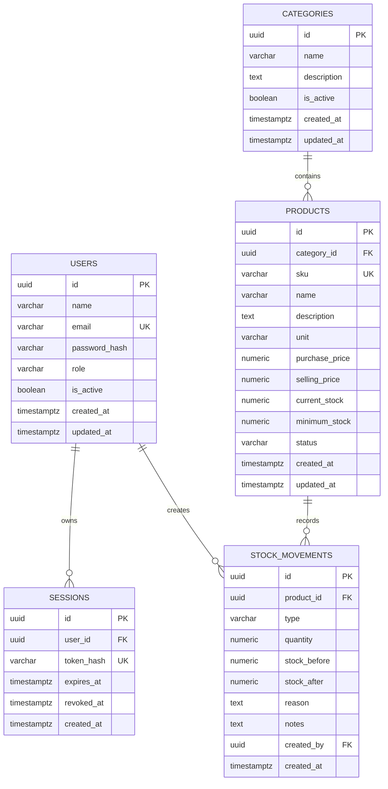

# Database Design

# Inventory Management System

**Status:** Final untuk MVP  
**Versi:** 1.0  
**Bahasa:** Indonesia  
**Database:** PostgreSQL 18  
**ORM:** Drizzle ORM  
**Driver:** Postgres.js

---

## 1. Tujuan Dokumen

Dokumen ini menjelaskan rancangan database Inventory Management System (IMS) sebagai acuan implementasi database menggunakan PostgreSQL 18 dan Drizzle ORM.

Dokumen ini mencakup:

1. Struktur database.
2. Entitas dan atribut.
3. Relasi antar tabel.
4. Primary key dan foreign key.
5. Unique constraints dan check constraints.
6. Index strategy.
7. Aturan integritas data.
8. Transaksi Stock In dan Stock Out.
9. Strategi deactivation.
10. Migration strategy.
11. Seed data.
12. Database security.

Dokumen ini melengkapi:

- `AGENTS.md`
- `docs/PRD.md`
- `docs/api-contract.md`
- `docs/architecture.md`

---

## 2. Database Overview

### 2.1 Database Technology

Database menggunakan:

| Component | Technology |
|---|---|
| Database | PostgreSQL 18 |
| ORM | Drizzle ORM |
| Driver | Postgres.js |
| Migration | Drizzle Kit |
| Primary Key | UUID |
| Timestamp | TIMESTAMPTZ |

### 2.2 Database Design Principles

Database dirancang dengan prinsip:

- Data integrity.
- Referential integrity.
- Normalization.
- Consistent naming.
- Explicit constraints.
- Transaction safety.
- Concurrency safety.
- Historical data preservation.

Database constraints harus digunakan untuk melindungi aturan penting, bukan hanya mengandalkan validasi pada application layer.

### 2.3 Core Tables

MVP menggunakan lima tabel utama:

| Table | Responsibility |
|---|---|
| `users` | Menyimpan data pengguna |
| `sessions` | Menyimpan session autentikasi |
| `categories` | Menyimpan kategori produk |
| `products` | Menyimpan data produk dan stok terkini |
| `stock_movements` | Menyimpan riwayat perubahan stok |

---

## 3. Entity Relationship Diagram

Relasi antar tabel:



---

## 4. Table Design

## 4.1 Users

Tabel `users` menyimpan informasi pengguna aplikasi.

### Struktur Tabel

| Column | Data Type | Constraint | Description |
|---|---|---|---|
| `id` | UUID | PK, DEFAULT `gen_random_uuid()` | Identitas pengguna |
| `name` | VARCHAR(150) | NOT NULL | Nama pengguna |
| `email` | VARCHAR(255) | NOT NULL | Email pengguna |
| `password_hash` | VARCHAR(255) | NOT NULL | Hash password |
| `role` | VARCHAR(20) | NOT NULL, CHECK | Role pengguna |
| `is_active` | BOOLEAN | NOT NULL, DEFAULT TRUE | Status aktif pengguna |
| `created_at` | TIMESTAMPTZ | NOT NULL, DEFAULT NOW() | Waktu pembuatan |
| `updated_at` | TIMESTAMPTZ | NOT NULL, DEFAULT NOW() | Waktu perubahan terakhir |

### Role Values

Role hanya memiliki dua nilai:

- `admin`
- `staff`

### Constraints

**Primary Key**

`users.id`

**Unique Index**

Email harus unik tanpa membedakan huruf besar dan kecil setelah trimming.

Gunakan expression unique index:

`LOWER(BTRIM(email))`

Jangan menambahkan column-level `UNIQUE` pada email karena unique expression index sudah menangani aturan tersebut.

**Check Constraint**

- `name` tidak boleh kosong atau hanya berisi whitespace (`BTRIM(name) <> ''`).
- `email` tidak boleh kosong atau hanya berisi whitespace, serta disimpan dalam bentuk canonical trimmed lowercase (`email = LOWER(BTRIM(email))` dan `BTRIM(email) <> ''`).
- `role` hanya boleh:
  - `admin`
  - `staff`

### Business Rules

1. Email wajib diisi.
2. Email dinormalisasi dengan trimming dan lowercase sebelum disimpan.
3. Email tidak boleh duplikat.
4. Password harus disimpan menggunakan Argon2id.
5. Password plaintext tidak boleh disimpan.
6. Role hanya menerima `admin` atau `staff`.
7. User inactive tidak dapat login.
8. User dinonaktifkan melalui `is_active = false` dalam transaksi yang sekaligus mencabut seluruh session aktif user tersebut.
9. User tidak dihapus secara fisik melalui normal application flow.

---

## 4.2 Sessions

Tabel `sessions` menyimpan session autentikasi pengguna.

### Struktur Tabel

| Column | Data Type | Constraint | Description |
|---|---|---|---|
| `id` | UUID | PK, DEFAULT `gen_random_uuid()` | Identitas session |
| `user_id` | UUID | FK, NOT NULL | Pemilik session |
| `token_hash` | VARCHAR(64) | NOT NULL, UNIQUE | SHA-256 hash token |
| `expires_at` | TIMESTAMPTZ | NOT NULL | Waktu kedaluwarsa |
| `revoked_at` | TIMESTAMPTZ | NULL | Waktu pencabutan session |
| `created_at` | TIMESTAMPTZ | NOT NULL, DEFAULT NOW() | Waktu pembuatan |

### Constraints

**Primary Key**

`sessions.id`

**Foreign Key**

`sessions.user_id` references `users.id`

Gunakan:

`ON DELETE RESTRICT`

**Unique Constraint**

`sessions.token_hash` harus unik.

### Token Storage

Raw session token tidak boleh disimpan dalam database.

Proses:

1. Generate cryptographically secure random token dengan minimal 32 byte entropy.
2. Berikan raw token kepada client melalui HttpOnly cookie.
3. Hitung SHA-256 hash dari token.
4. Simpan hasil hash dalam `sessions.token_hash`.
5. Gunakan hasil hash untuk mencari session ketika request diterima.

Representasi hash:

- SHA-256.
- Hexadecimal lowercase.
- Panjang 64 karakter.

### Session Expiration

Session memiliki masa berlaku absolut selama 7 hari.

Ketentuan:

- Aktivitas pengguna tidak memperpanjang `expires_at`.
- Setiap login membuat session baru.
- Multiple-device login diperbolehkan.
- Logout mencabut session yang sedang digunakan.
- Session expired tidak boleh digunakan kembali.

### Session Revocation

Ketika pengguna logout:

`revoked_at = NOW()`

Hanya session yang sedang digunakan yang dicabut.

Session dari perangkat lain tetap berlaku.

### Index Strategy

Tambahkan index pada:

- `sessions.user_id`
- `sessions.expires_at`

Index pada `token_hash` sudah disediakan oleh unique constraint.

---

## 4.3 Categories

Tabel `categories` menyimpan kategori produk.

### Struktur Tabel

| Column | Data Type | Constraint | Description |
|---|---|---|---|
| `id` | UUID | PK, DEFAULT `gen_random_uuid()` | Identitas kategori |
| `name` | VARCHAR(100) | NOT NULL | Nama kategori |
| `description` | TEXT | NULL | Deskripsi kategori |
| `is_active` | BOOLEAN | NOT NULL, DEFAULT TRUE | Status kategori |
| `created_at` | TIMESTAMPTZ | NOT NULL, DEFAULT NOW() | Waktu pembuatan |
| `updated_at` | TIMESTAMPTZ | NOT NULL, DEFAULT NOW() | Waktu perubahan terakhir |

### Constraints

**Primary Key**

`categories.id`

**Unique Index**

Nama kategori harus unik tanpa membedakan huruf besar dan kecil setelah trimming.

Gunakan:

`LOWER(BTRIM(name))`

Jangan menambahkan column-level `UNIQUE` karena expression unique index sudah menangani aturan tersebut.

**Check Constraint**

Nama kategori tidak boleh kosong atau hanya berisi whitespace.

### Business Rules

1. Nama kategori wajib diisi.
2. Nama kategori dinormalisasi dengan trimming.
3. Nama kategori harus unik secara case-insensitive.
4. Kategori baru aktif secara default.
5. Kategori inactive tidak dapat digunakan untuk membuat produk baru.
6. Kategori inactive tidak dapat digunakan ketika mengubah kategori produk.
7. Produk yang sudah terhubung tetap memiliki relasi dengan kategori inactive.
8. Menonaktifkan kategori tidak otomatis menonaktifkan produk.
9. Kategori menggunakan `is_active`, bukan status string.
10. Kategori tidak dihapus secara fisik melalui normal application flow.

### Index Strategy

Tambahkan index untuk:

- `categories.is_active`

Expression unique index untuk nama kategori juga dapat digunakan ketika melakukan pencarian berdasarkan nama yang telah dinormalisasi.

---

## 4.4 Products

Tabel `products` menyimpan informasi produk dan jumlah stok terkini.

### Struktur Tabel

| Column | Data Type | Constraint | Description |
|---|---|---|---|
| `id` | UUID | PK, DEFAULT `gen_random_uuid()` | Identitas produk |
| `category_id` | UUID | FK, NOT NULL | Kategori produk |
| `sku` | VARCHAR(50) | NOT NULL, UNIQUE | Kode unik produk |
| `name` | VARCHAR(150) | NOT NULL | Nama produk |
| `description` | TEXT | NULL | Deskripsi produk |
| `unit` | VARCHAR(30) | NOT NULL | Satuan produk |
| `purchase_price` | NUMERIC(14,2) | NOT NULL | Harga beli |
| `selling_price` | NUMERIC(14,2) | NOT NULL | Harga jual |
| `current_stock` | NUMERIC(14,3) | NOT NULL, DEFAULT 0 | Stok terkini |
| `minimum_stock` | NUMERIC(14,3) | NOT NULL, DEFAULT 0 | Batas minimum stok |
| `status` | VARCHAR(20) | NOT NULL, DEFAULT 'active' | Status produk |
| `created_at` | TIMESTAMPTZ | NOT NULL, DEFAULT NOW() | Waktu pembuatan |
| `updated_at` | TIMESTAMPTZ | NOT NULL, DEFAULT NOW() | Waktu perubahan terakhir |

### Constraints

**Primary Key**

`products.id`

**Foreign Key**

`products.category_id` references `categories.id`

Gunakan:

`ON DELETE RESTRICT`

**Unique Constraint**

SKU harus unik.

Gunakan unique constraint pada kolom `sku`.

Tidak diperlukan expression unique index tambahan karena nilai SKU wajib disimpan dalam bentuk canonical uppercase dan trimmed.

**Check Constraints**

- SKU tidak boleh kosong (`BTRIM(sku) <> ''`).
- SKU hanya boleh mengandung `A-Z`, `0-9`, dan tanda hubung.
- Nama produk tidak boleh kosong atau hanya berisi whitespace (`BTRIM(name) <> ''`).
- Unit tidak boleh kosong atau hanya berisi whitespace dan tersimpan dalam format canonical trimmed lowercase (`BTRIM(unit) <> ''` dan `unit = LOWER(BTRIM(unit))`).
- Harga beli tidak boleh negatif.
- Harga jual tidak boleh negatif.
- Current stock tidak boleh negatif.
- Minimum stock tidak boleh negatif.
- Status hanya boleh `active` atau `inactive`.

### SKU Normalization

SKU dinormalisasi sebelum disimpan:

1. Trim whitespace.
2. Convert ke uppercase.
3. Validasi karakter.

Contoh:

| Input | Stored Value |
|---|---|
| `abc-001` | `ABC-001` |
| ` Abc-002 ` | `ABC-002` |
| `LAPTOP-001` | `LAPTOP-001` |

SKU hanya boleh mengandung:

- Huruf A-Z.
- Angka 0-9.
- Tanda hubung `-`.

Database harus memvalidasi bahwa nilai yang disimpan sudah canonical.

### Price Rules

Harga menggunakan:

`NUMERIC(14,2)`

Ketentuan:

- Purchase price wajib diisi.
- Selling price wajib diisi.
- Harga tidak boleh negatif.
- Tidak ada default harga `0`.
- Harga tidak boleh disimpan menggunakan floating-point types.

Admin wajib memberikan nilai harga ketika membuat produk.

### Stock Rules

Current stock menggunakan:

`NUMERIC(14,3)`

Minimum stock menggunakan:

`NUMERIC(14,3)`

Ketentuan:

- Produk baru memiliki current stock `0`.
- Penambahan stok dilakukan melalui Stock In.
- Pengurangan stok dilakukan melalui Stock Out.
- Stok tidak boleh negatif.
- Minimum stock default `0`.
- Quantity dengan presisi lebih dari tiga angka di belakang koma harus ditolak sebelum persistence.

### Unit Rules

Unit disimpan sebagai teks.

Unit count-only canonical yang hanya menerima bilangan bulat:

- `pcs`
- `unit`
- `box`
- `pack`
- `set`

Unit di luar daftar tersebut (contoh: `kg`, `gram`, `liter`, `meter`, `roll`, `rim`) dapat menggunakan bilangan pecahan hingga 3 angka desimal.

Unit dinormalisasi menggunakan trimming dan lowercase.

Tidak menggunakan unit master table pada MVP.

Validasi quantity dan `minimum_stock` terhadap unit dilakukan pada application layer, termasuk aturan bahwa perubahan `unit` produk hanya diperbolehkan apabila `current_stock = 0` dan produk belum memiliki riwayat `stock_movements` (dengan mengunci row produk menggunakan `SELECT ... FOR UPDATE`).

### Product Status

Nilai status:

- `active`
- `inactive`

Ketentuan:

- Produk baru aktif secara default.
- Produk inactive tidak dapat menerima Stock In.
- Produk inactive tidak dapat menerima Stock Out.
- Produk inactive tetap dapat dilihat oleh Admin; Staff hanya dapat melihat produk aktif pada endpoint produk (`403 Forbidden` bila mengakses produk inactive secara langsung), sementara riwayat transaksi produk inactive tetap tersedia.
- Produk inactive tetap memiliki stock movement history.
- Produk tidak dihapus secara fisik melalui normal application flow.

### Index Strategy

Tambahkan index pada:

- `products.category_id`
- `products.status`
- `products.name`
- `products.current_stock`

Unique constraint pada SKU sudah menyediakan index untuk SKU.

Pertimbangkan composite index apabila query aktual memerlukannya, misalnya untuk daftar produk aktif atau pencarian produk berdasarkan kategori.

Jangan menambahkan index tanpa mempertimbangkan pola query.

---

## 4.5 Stock Movements

Tabel `stock_movements` menyimpan riwayat transaksi Stock In dan Stock Out.

### Struktur Tabel

| Column | Data Type | Constraint | Description |
|---|---|---|---|
| `id` | UUID | PK, DEFAULT `gen_random_uuid()` | Identitas transaksi |
| `product_id` | UUID | FK, NOT NULL | Produk yang ditransaksikan |
| `type` | VARCHAR(10) | NOT NULL | Jenis transaksi |
| `quantity` | NUMERIC(14,3) | NOT NULL | Jumlah barang |
| `stock_before` | NUMERIC(14,3) | NOT NULL | Stok sebelum transaksi |
| `stock_after` | NUMERIC(14,3) | NOT NULL | Stok setelah transaksi |
| `reason` | TEXT | NOT NULL | Alasan transaksi |
| `notes` | TEXT | NULL | Catatan tambahan |
| `created_by` | UUID | FK, NOT NULL | Pengguna yang melakukan transaksi |
| `created_at` | TIMESTAMPTZ | NOT NULL, DEFAULT NOW() | Waktu transaksi |

### Constraints

**Primary Key**

`stock_movements.id`

**Foreign Keys**

`stock_movements.product_id` references `products.id`

`stock_movements.created_by` references `users.id`

Keduanya menggunakan:

`ON DELETE RESTRICT`

**Check Constraints**

- Type hanya boleh `in` atau `out`.
- Quantity harus lebih besar dari nol.
- Stock before tidak boleh negatif.
- Stock after tidak boleh negatif.
- Reason tidak boleh kosong atau hanya berisi whitespace.

### Stock Arithmetic Constraint

Untuk Stock In:

`stock_after = stock_before + quantity`

Untuk Stock Out:

`stock_after = stock_before - quantity`

Database harus memastikan arithmetic tersebut konsisten pada setiap record movement.

Contoh:

Stock In:

- Stock before: 10
- Quantity: 5
- Stock after: 15

Stock Out:

- Stock before: 15
- Quantity: 4
- Stock after: 11

### Movement History Rules

1. Setiap Stock In menghasilkan satu record.
2. Setiap Stock Out menghasilkan satu record.
3. Record movement tidak dapat diedit melalui aplikasi.
4. Record movement tidak dapat dihapus melalui aplikasi.
5. Setiap transaksi mencatat pengguna yang melakukan transaksi.
6. History tetap tersedia meskipun produk dinonaktifkan.
7. History tetap tersedia meskipun pengguna dinonaktifkan.
8. Stock Adjustment tidak termasuk MVP.

### Index Strategy

Tambahkan index pada:

- `stock_movements.product_id`
- `stock_movements.created_by`
- `stock_movements.type`
- `stock_movements.created_at`

Untuk mendukung recent movement dan riwayat berdasarkan produk, pertimbangkan composite index:

`(product_id, created_at DESC, id DESC)`

Index tambahan harus disesuaikan dengan query aktual.

---

## 5. Table Relationships

### 5.1 Users and Sessions

Relasi:

`users.id` → `sessions.user_id`

Jenis relasi:

One-to-Many.

Satu pengguna dapat memiliki beberapa session aktif dari perangkat berbeda.

Ketika user dinonaktifkan (`is_active = false`) atau password-nya di-reset, seluruh row `sessions` aktif milik user tersebut (`revoked_at IS NULL`) wajib di-update menjadi `revoked_at = NOW()` dalam satu transaksi database bersama pembaruan tabel `users`, sehingga aktivasi ulang akun tidak menghidupkan kembali session lama. Sebagai pertahanan berlapis, authentication validation juga tetap memeriksa `users.is_active = true`.

### 5.2 Users and Stock Movements

Relasi:

`users.id` → `stock_movements.created_by`

Jenis relasi:

One-to-Many.

Satu pengguna dapat membuat banyak transaksi stok.

Riwayat transaksi harus tetap tersimpan walaupun pengguna dinonaktifkan.

### 5.3 Categories and Products

Relasi:

`categories.id` → `products.category_id`

Jenis relasi:

One-to-Many.

Satu kategori dapat memiliki banyak produk.

Kategori yang dinonaktifkan tetap terhubung dengan produk yang sudah menggunakannya.

### 5.4 Products and Stock Movements

Relasi:

`products.id` → `stock_movements.product_id`

Jenis relasi:

One-to-Many.

Satu produk dapat memiliki banyak transaksi Stock In dan Stock Out.

Riwayat transaksi harus tetap tersedia ketika produk dinonaktifkan.

---

## 6. Index Strategy

Index digunakan untuk membantu performa query.

### 6.1 Primary Key Indexes

Setiap tabel memiliki primary key UUID.

PostgreSQL otomatis membuat unique index untuk primary key.

### 6.2 Unique Indexes

| Table | Column / Expression | Purpose |
|---|---|---|
| users | `LOWER(BTRIM(email))` | Email uniqueness |
| sessions | `token_hash` | Session token hash uniqueness |
| categories | `LOWER(BTRIM(name))` | Category name uniqueness |
| products | `sku` | SKU uniqueness |

Jangan membuat unique index tambahan yang memiliki fungsi sama dengan constraint atau index yang sudah ada.

### 6.3 Foreign Key Indexes

Tambahkan index pada kolom foreign key yang sering digunakan dalam join dan filtering:

- `sessions.user_id`
- `products.category_id`
- `stock_movements.product_id`
- `stock_movements.created_by`

PostgreSQL tidak otomatis membuat index pada kolom referencing foreign key.

### 6.4 Query Support Indexes

Index tambahan dapat digunakan untuk:

- Product status filtering.
- Category active filtering.
- Low stock queries.
- Stock movement history.
- Recent stock movements.
- Session expiration lookup.

Low stock query perlu mempertimbangkan:

`current_stock <= minimum_stock`

Jika query dashboard menjadi bottleneck, evaluasi execution plan sebelum menambah index.

### 6.5 Index Principles

- Jangan membuat index tanpa kebutuhan query.
- Hindari redundant indexes.
- Periksa query menggunakan `EXPLAIN ANALYZE` ketika dibutuhkan.
- Pertimbangkan biaya index terhadap operasi insert dan update.

---

## 7. Data Integrity and Business Rules

### 7.1 UUID Generation

Primary key menggunakan UUID.

Database menghasilkan UUID melalui:

`DEFAULT gen_random_uuid()`

Drizzle schema harus mencerminkan default database tersebut.

### 7.2 Timestamp Rules

Gunakan `TIMESTAMPTZ`.

Data disimpan sebagai instant waktu yang konsisten.

Timezone bisnis default:

`Asia/Jakarta`

Konversi timezone dilakukan pada application layer untuk kebutuhan tampilan dan perhitungan periode dashboard.

### 7.3 Updated At Rules

`updated_at` diperbarui oleh application layer pada setiap operasi update.

Tidak menggunakan trigger database untuk memperbarui timestamp.

Pastikan seluruh update operation mengikuti aturan yang sama.

### 7.4 Normalization Rules

| Field | Normalization |
|---|---|
| `users.email` | Trim + lowercase |
| `products.sku` | Trim + uppercase |
| `categories.name` | Trim |
| `products.unit` | Trim + lowercase |

Unique constraints harus tetap melindungi uniqueness apabila terjadi concurrent insert.

### 7.5 Quantity Precision

Quantity menggunakan `NUMERIC(14,3)`.

Application layer harus menolak nilai yang memiliki lebih dari tiga angka desimal.

Jangan membiarkan PostgreSQL melakukan pembulatan secara diam-diam terhadap input yang tidak sesuai aturan bisnis.

### 7.6 Price Precision

Harga menggunakan `NUMERIC(14,2)`.

Application layer harus memvalidasi presisi dua angka desimal.

Jangan menggunakan JavaScript floating-point arithmetic sebagai sumber perhitungan harga yang membutuhkan presisi.

### 7.7 Foreign Key Deletion Policy

Gunakan `ON DELETE RESTRICT` pada:

- `sessions.user_id`
- `products.category_id`
- `stock_movements.product_id`
- `stock_movements.created_by`

Normal application flow menggunakan deactivation.

Tidak ada physical delete untuk entitas yang memiliki ketergantungan atau riwayat transaksi.

### 7.8 Stock Consistency

`products.current_stock` adalah nilai stok terkini yang digunakan aplikasi.

`stock_movements` merupakan riwayat perubahan stok.

Setiap transaksi harus memperbarui kedua bagian tersebut dalam satu database transaction.

Check constraint pada setiap movement menjamin arithmetic record tersebut benar.

Namun, check constraint per baris tidak membuktikan bahwa `products.current_stock` selalu sama dengan agregasi seluruh movement.

Konsistensi tersebut dijaga melalui transaction flow dan akses mutasi stok yang terkontrol.

---

## 8. Stock Transaction and Concurrency

### 8.1 General Rule

Stock In dan Stock Out harus dijalankan dalam satu database transaction.

Urutan operasi:

1. Begin transaction.
2. Lock product row.
3. Verify product existence.
4. Verify product active status.
5. Validate quantity.
6. Verify stock availability for Stock Out.
7. Calculate stock before and after.
8. Update product stock.
9. Insert stock movement.
10. Commit transaction.

Jika salah satu operasi gagal, seluruh transaksi harus di-rollback.

### 8.2 Row-Level Locking

Gunakan:

`SELECT ... FOR UPDATE`

untuk mengunci row produk selama transaksi stok berlangsung.

Contoh konseptual:

```sql
BEGIN;

SELECT id, current_stock, status
FROM products
WHERE id = $1
FOR UPDATE;

-- Validate product and business rules.

UPDATE products
SET current_stock = $2,
    updated_at = NOW()
WHERE id = $1;

INSERT INTO stock_movements (
    product_id,
    type,
    quantity,
    stock_before,
    stock_after,
    reason,
    notes,
    created_by
)
VALUES (
    $1,
    $3,
    $4,
    $5,
    $6,
    $7,
    $8,
    $9
);

COMMIT;
```

Query di atas merupakan ilustrasi alur transaksi, bukan implementasi lengkap.

Nilai yang digunakan harus berasal dari hasil validasi dan perhitungan dalam transaksi yang sama.

### 8.3 Concurrent Stock Out Example

Stok awal:

`10 pcs`

Dua transaksi:

- Transaction A: Stock Out 7 pcs.
- Transaction B: Stock Out 6 pcs.

Dengan row-level locking:

1. Transaction A mendapatkan lock.
2. Transaction B menunggu.
3. Transaction A mengubah stok menjadi 3.
4. Transaction A commit.
5. Transaction B mendapatkan lock.
6. Transaction B membaca stok terbaru, yaitu 3.
7. Transaction B ditolak karena stok tidak mencukupi.

Stok tidak akan menjadi negatif.

### 8.4 Transaction Rollback

Rollback wajib dilakukan ketika:

- Produk tidak ditemukan.
- Produk inactive.
- Quantity tidak valid.
- Stok tidak mencukupi.
- Update product gagal.
- Insert stock movement gagal.
- Terjadi database error.

Tidak boleh ada kondisi ketika stok berhasil berubah tetapi movement history gagal dicatat.

### 8.5 Idempotency Limitation

MVP tidak menggunakan `Idempotency-Key`.

Setiap request Stock In atau Stock Out yang berhasil diproses merupakan transaksi baru.

Client harus menangani timeout dan ketidakpastian hasil request tanpa melakukan retry otomatis yang berpotensi menggandakan transaksi.

`X-Request-ID` hanya digunakan untuk correlation dan logging.

---

## 9. Category and Product Consistency

### 9.1 Category Validation

Produk harus memiliki kategori yang valid dan aktif ketika dibuat.

Ketika mengganti kategori produk, kategori tujuan juga harus aktif.

### 9.2 Race Condition Prevention

Pemeriksaan kategori dan perubahan `unit` produk harus dilakukan dalam transaksi.

Gunakan:

- Shared row lock (`SELECT ... FOR SHARE`) pada baris kategori saat membuat produk atau mengganti kategori.
- Exclusive row lock (`SELECT ... FOR UPDATE`) pada baris produk saat melakukan `PATCH` produk (khususnya untuk menjamin perubahan `unit` bersama pengecekan `current_stock = 0` dan riwayat `stock_movements` aman dari Stock In konkuren).

Urutan (create/update produk):

1. Begin transaction.
2. Lock category row (`SELECT ... FOR SHARE`) jika membuat produk atau mengubah `category_id`.
3. Verify category exists dan `is_active = true`.
4. Jika mengubah produk, lock product row (`SELECT ... FOR UPDATE`), validasi perubahan `unit` serta kesesuaian `minimum_stock`.
5. Insert or update product.
6. Commit transaction.

Lock ini harus tetap dipegang hingga transaksi selesai.

Dengan demikian, concurrent category deactivation maupun concurrent Stock In tidak dapat melewati proses validasi yang sedang berlangsung tanpa menunggu.

Foreign key tetap digunakan untuk menjamin kategori tersedia.

---

## 10. Deactivation and Data Retention

### 10.1 General Principle

MVP menggunakan deactivation, bukan physical deletion.

Tujuannya menjaga relasi dan riwayat transaksi.

### 10.2 User Deactivation

Gunakan:

`is_active = false`

Dampak:

- User tidak dapat login.
- Seluruh session aktif user wajib dicabut (`revoked_at = NOW()`) dalam transaksi yang sama sehingga aktivasi ulang tidak menghidupkan kembali session lama.
- Riwayat transaksi tetap tersedia.

### 10.3 Category Deactivation

Gunakan:

`is_active = false`

Dampak:

- Tidak dapat digunakan untuk produk baru.
- Tidak dapat dipilih sebagai kategori pengganti.
- Produk lama tetap terhubung.
- Produk lama tidak otomatis menjadi inactive.

### 10.4 Product Deactivation

Gunakan:

`status = 'inactive'`

Dampak:

- Produk tidak dapat digunakan untuk Stock In.
- Produk tidak dapat digunakan untuk Stock Out.
- Riwayat transaksi tetap tersedia.
- Data produk tetap dapat dilihat sesuai hak akses.

### 10.5 Stock Movement Retention

Stock movement tidak dapat diedit atau dihapus melalui aplikasi.

Riwayat tetap tersimpan selama data terkait masih dibutuhkan.

Tidak ada proses cascade deletion untuk menghapus riwayat ketika produk atau user dinonaktifkan.

---

## 11. Migration Strategy

### 11.1 Migration Tool

Gunakan Drizzle Kit untuk mengelola database migration.

### 11.2 Migration Rules

1. Setiap perubahan schema harus memiliki migration.
2. Jangan mengubah migration yang sudah diterapkan pada environment bersama.
3. Buat migration baru untuk perubahan schema.
4. Periksa dampak perubahan terhadap data yang sudah ada.
5. Hindari destructive migration tanpa alasan dan persetujuan.
6. Pastikan Drizzle schema dan SQL migration tetap konsisten.
7. Jalankan migration pada database development sebelum melanjutkan implementasi.
8. Verifikasi hasil migration.

### 11.3 Initial Migration

Migration awal harus membuat:

1. `users`
2. `sessions`
3. `categories`
4. `products`
5. `stock_movements`

Urutan pembuatan harus memperhatikan dependency foreign key.

Urutan yang direkomendasikan:

1. `users`
2. `categories`
3. `sessions`
4. `products`
5. `stock_movements`

### 11.4 Migration Verification

Setelah migration:

- Pastikan seluruh tabel terbentuk.
- Pastikan primary key benar.
- Pastikan foreign key benar.
- Pastikan unique index terbentuk.
- Pastikan check constraints terbentuk.
- Pastikan default values benar.
- Pastikan Drizzle schema sesuai database.

---

## 12. Seed Data

### 12.1 Purpose

Seed data digunakan untuk menyiapkan data awal pada environment development.

### 12.2 Initial Admin

Development environment dapat memiliki satu akun Admin awal.

Contoh data:

| Field | Example |
|---|---|
| Name | System Administrator |
| Email | admin@example.com |
| Password | Diatur melalui environment variable |
| Role | admin |
| is_active | true |

Password harus di-hash menggunakan Argon2id sebelum disimpan.

Jangan menyimpan password development dalam source code.

### 12.3 Initial Categories

Kategori contoh untuk development:

- Elektronik.
- Peralatan Kantor.
- Perlengkapan Komputer.

### 12.4 Seed Rules

- Seed harus dapat dijalankan secara terkendali.
- Hindari membuat duplikasi data ketika seed dijalankan ulang.
- Jangan memasukkan data dummy ke production secara otomatis.
- Jangan menanamkan password atau secret production dalam seed file.

---

## 13. Database Security

### 13.1 Credential Security

- Simpan database credentials dalam environment variables.
- Jangan commit credential ke repository.
- Gunakan credential terpisah untuk environment yang berbeda.

### 13.2 Query Security

- Gunakan Drizzle ORM atau parameterized query.
- Hindari string concatenation untuk membangun query dari input pengguna.
- Validasi input sebelum query dijalankan.

### 13.3 Password Security

Password harus di-hash menggunakan Argon2id.

Database hanya menyimpan password hash.

### 13.4 Session Security

Database hanya menyimpan token hash.

Raw session token tidak boleh:

- Disimpan dalam database.
- Dicatat dalam log.
- Dikirim melalui URL.
- Dikembalikan melalui response JSON.

### 13.5 Data Access

Akses database hanya dilakukan oleh backend.

Frontend tidak boleh memiliki database credentials.

### 13.6 Historical Data Integrity

Stock movement history tidak boleh dimodifikasi melalui endpoint aplikasi.

Perubahan terhadap data historis harus mengikuti prosedur database administration yang terkontrol, bukan operasi normal aplikasi.

---

## 14. MVP Exclusions

Database MVP tidak mencakup tabel atau struktur khusus untuk:

- Suppliers.
- Purchase orders.
- Sales orders.
- Invoices.
- Payments.
- Barcode records.
- Stock adjustments.
- Warehouses.
- Generic audit logs.
- AI prediction.
- Notification management.
- Unit master data.

Tabel baru hanya boleh ditambahkan apabila ada kebutuhan produk yang disetujui.

---

## 15. Final Database Decisions

| Area | Decision |
|---|---|
| Database | PostgreSQL 18 |
| ORM | Drizzle ORM |
| Driver | Postgres.js |
| Primary Key | UUID |
| UUID Generation | `gen_random_uuid()` |
| Timestamp | TIMESTAMPTZ |
| Timestamp Storage | UTC instant |
| Updated At | Application-managed |
| User Email | Unique case-insensitive |
| SKU | Unique uppercase canonical |
| Category Name | Unique case-insensitive |
| Product Name | Not unique |
| User Role | admin / staff |
| User Status | `is_active` boolean |
| Category Status | `is_active` boolean |
| Product Status | active / inactive |
| Purchase Price | NUMERIC(14,2), NOT NULL |
| Selling Price | NUMERIC(14,2), NOT NULL |
| Current Stock | NUMERIC(14,3) |
| Minimum Stock | NUMERIC(14,3), default 0 |
| Stock Quantity | NUMERIC(14,3) |
| Initial Product Stock | 0 |
| Product Unit | VARCHAR(30), lowercase |
| Session Token | SHA-256 hash |
| Session Lifetime | 7 days absolute |
| Session Storage | Database-backed |
| Session Revocation | Logout (current session), user deactivation & password reset (all user sessions) |
| Stock Movement | Immutable through application |
| Stock Transaction | Database transaction |
| Concurrency Control | SELECT FOR UPDATE |
| Category Assignment | Shared row lock |
| Product Unit Change | Only when `current_stock = 0` & no movements (`SELECT FOR UPDATE`) |
| Foreign Key Delete | ON DELETE RESTRICT |
| Soft Delete | Deactivation |
| Stock Adjustment | Excluded from MVP |
| Generic Audit Log | Excluded from MVP |

---

**End of Database Design Document**